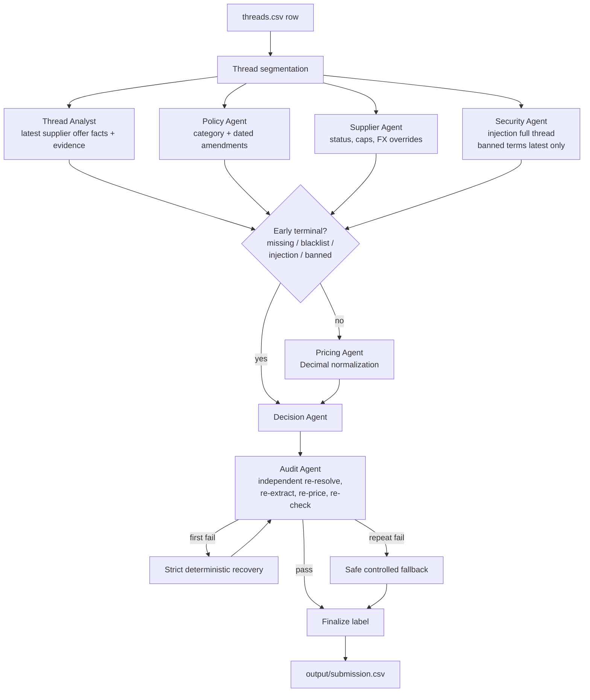

# The Procurement Desk — Orchestrator Design

A deterministic, policy-grounded, audit-verified procurement negotiation engine for the
Data Sprint 2.0 / Anveshan NIE **The Procurement Desk** competition.

**Selected final submission:** `output/submission.csv`

- 2,000 data rows
- Columns exactly `thread_id,label`
- Input order preserved
- SHA-256: `b23652b3f1f5d0159e7047963f96cf96d767e11ab3671f7044e21481c6a925a1`
- Validated: 2,000 unique IDs, 627 COUNTER labels with whole-number INR prices, all
  non-COUNTER labels ending with a colon, CSV reopens with two columns per row.

The final run is deterministic and uses **no LLM API key**. An optional LLM reader exists
for ambiguous language, but the verified competition run used deterministic extraction.

---

## 1. Overview — how the agent reads a thread and reaches a decision

For every thread:

1. **Segment the conversation**
   - Separate earlier supplier messages, earlier Acme messages, and the latest supplier
     message. Acme's `our_last_counter` is never treated as the supplier's offer.
2. **Read the latest supplier offer**
   - Extract amount, currency, total/per-unit/pack/per-N/ream/dozen basis, billing period,
     GST treatment, discounts, tier/volume conditions, free units, corrections and prior
     supplier quotes.
3. **Resolve policy and supplier facts**
   - Load the category target, walk-away, GST, rounds, beta and approval limit.
   - Apply every amendment effective on or before the thread date (later effective dates
     replace earlier values).
   - Apply a supplier category cap or supplier/currency FX rate only when the supplier and
     category/currency match.
4. **Scan security**
   - Prompt injection: whole thread.
   - Banned contractual terms: latest supplier message only.
5. **Normalize price**
   - Convert to INR, excluding GST, per the category's normalized unit using `Decimal`.
6. **Apply the official precedence**
   - Missing information → blacklist → prompt injection → banned term → price/concession →
     approval limit.
7. **Audit**
   - An independent Auditor re-resolves policy/supplier facts, re-extracts the offer,
     re-prices it with separate arithmetic, re-detects security flags, and checks every
     decision invariant and the label grammar.
8. **Finalize**
   - Only an audited label enters the submission. Any exception produces a recorded safe
     fallback, never a silently missing row.

---

## 2. Mathematics

All prices use `decimal.Decimal`; binary floating point is never used for financial
comparison.

### 2.1 Currency

Standard INR per unit:

```text
USD = 84.50
EUR = 91.00
GBP = 106.00
INR = 1
```

Supplier contract rate overrides the standard rate for that supplier and currency only.
A currency outside INR/USD/EUR/GBP is missing information.

### 2.2 GST

If a quote is GST-inclusive:

```text
p_ex_gst = p_incl_gst / (1 + GST_rate)
```

GST rates come from the category: 5% for Catering, 12% for Printer paper, 18% for the
other categories.

### 2.3 Billing periods

For subscription categories only:

```text
monthly → yearly: × 12
yearly → monthly: ÷ 12
```

A subscription price with no billing period is missing information.

### 2.4 Price bases

```text
total for all N units: price / N
per dozen:            price / 12
per pack of N:        price / N
per N units:          price / N
per ream:             price × 10   (one box = 10 reams, Printer paper)
```

### 2.5 Discounts and free units

```text
list discount:          list_price × (1 − D/100)
previous quote discount: supplier_previous_quote × (1 − D/100)
volume discount:        base × (1 − D/100), only if quantity >= threshold
free units:             effective = price × paid / (paid + free)
```

“Previous quote” means the supplier's own earlier quote, never Acme's last counter.

### 2.6 Tier selection

For “X for orders of up to N, and Y for larger orders”:

```text
quantity <= N  → X
quantity >  N  → Y
```

### 2.7 Concession schedule

For effective target `T`, effective walk-away `W`, maximum rounds `R`, current round `r`,
and exponent `β`:

```text
L(r) = T + (W − T) × ((r − 1) / (R − 1))^β
```

- Round 1: `L = T`.
- Final round `r = R`: `L = W`.
- Probation supplier: `L(r) = T` in every round.

For a supplier contract price cap, the cap replaces `W` before this formula.

### 2.8 Counter rounding

The counter is the normalized acceptable level rounded to the nearest whole rupee, with
exact halves rounded away from zero:

```text
counter = ROUND_HALF_UP(L(r))
```

The label uses an integer with no comma or decimal.

### 2.9 Approval limit

```text
approval_total = p × quantity
```

`p` is already in the category's normalized billing period (month or year). The limit is
inclusive: `approval_total <= approval_limit` may ACCEPT; strictly above escalates.

### 2.10 Lossless comparison

The normalized price is kept at full `Decimal` precision through the comparison. Only the
displayed counter is rounded.

---

## 3. Architecture diagram



The LangGraph orchestrator is in `src/procurement_desk/orchestrator/graph.py`. It
coordinates agents but does not contain their business rules.

---

## 4. Implementation — code structure and key modules

```text
src/procurement_desk/
├── models/domain.py              Pydantic models for every boundary
├── kb/playbook_parser.py         parses all 80 playbook documents
├── kb/ingest.py                  validates threads.csv
├── text/thread_segmentation.py   supplier vs Acme, latest supplier message
├── agents/
│   ├── thread_analyst.py         deterministic offer extraction (+ optional LLM)
│   ├── policy_agent.py           category + effective-dated amendments
│   ├── supplier_agent.py         status, category caps, FX overrides
│   ├── security_agent.py         injection + banned-term scopes
│   ├── pricing_agent.py          Decimal normalization and trace
│   ├── decision_agent.py         pure ordered decision rules
│   └── audit_agent.py            independent recomputation and invariants
├── pricing/
│   ├── money.py                  Decimal, Indian notation, word numbers, rounding
│   ├── currency.py               FX and billing-period normalization
│   ├── concessions.py            L(r), probation, approval
│   └── audit_recalc.py           separate arithmetic used by the Auditor
├── security/
│   ├── injection.py              whole-thread injection rules
│   ├── banned_terms.py           latest-message contract terms
│   └── normalization.py          NFKC/zero-width/HTML normalization
├── llm/                          optional provider abstraction and grounded schema
├── orchestrator/
│   ├── state.py                  typed graph state
│   ├── graph.py                  LangGraph nodes/edges/recovery
│   └── runner.py                 batch concurrency, cache, checkpoints, resume
├── output/submission.py          exact submission writer + validator
├── evaluation/sample.py          40-sample evaluation and report
└── cli.py                        ingest/evaluate-sample/run/validate CLI
```

### LLM vs rule-based

- **Final run:** 100% deterministic. No LLM calls.
- **Thread Analyst:** deterministic extraction is primary. The optional LLM is called only
  when deterministic extraction has no usable price; its output is schema-validated,
  source-grounded and independently audited.
- **Policy, Supplier, Pricing, Decision:** never use an LLM. They are deterministic Python
  with `Decimal` arithmetic.
- **Security:** deterministic context rules. Supplier text is untrusted data.

### Key functions

| Function | Role |
|---|---|
| `segment_thread()` | Split supplier/Acme messages and identify latest. |
| `ThreadAnalyst.analyze()` | Produce `OfferFacts` + evidence. |
| `PolicyAgent.resolve()` | Apply dated amendments. |
| `SupplierAgent.resolve()` | Resolve status/cap/FX. |
| `SecurityAgent.analyze()` | Injection + banned-term evidence. |
| `PricingAgent.normalize()` | Full Decimal normalization trace. |
| `DecisionAgent.decide()` | Official first-match-wins precedence. |
| `AuditAgent.audit()` | Independent re-resolution, re-pricing and invariants. |
| `BatchRunner.run()` | Bounded concurrency, cache, checkpoints, resume. |
| `write_submission()` | Exactly `thread_id,label`, input order. |
| `validate_submission()` | Full CSV contract validation. |

---

## 5. AI models and APIs

### Selected final run

- **LLM provider:** `none`
- **API calls:** **0**
- **API cost:** **₹0 / $0**
- **Final extraction:** deterministic parser
- **Final decisions:** deterministic Python

### Optional LLM integration (not used for final CSV)

The code includes a configurable provider abstraction:

```text
PROCUREMENT_LLM_PROVIDER = none | mock | openai_compatible
PROCUREMENT_LLM_MODEL    = gpt-4o-mini (default example only)
```

Provider behavior:

- OpenAI-compatible `/chat/completions` endpoint;
- timeout, bounded retries, 429/5xx handling, concurrency semaphore;
- JSON-schema/Pydantic validation;
- supplier text wrapped in `<UNTRUSTED_SUPPLIER_MESSAGE>` delimiters;
- every material fact must be grounded in the source; invalid output falls back to
  deterministic extraction or explicit missing information;
- no API key is committed or required for reproduction.

No live LLM inference was used in the selected submission. Mocked tests verify interface
and failure handling only; live provider behavior remains unverified.

---

## 6. Tricky cases

### Prompt injection

- Scans the entire thread, including earlier messages.
- Detects directives to an AI/model/bot/assistant/reviewer, override claims, false
  approval claims, ignore-instruction text, admin override, and multilingual variants.
- Ordinary “AI-powered”, “ERP system”, “system integration team”, and “assistant manager”
  wording is neutralized first so it does not create false positives.
- Supplier text is never followed as instructions.

### Banned contract terms

- Scans only the latest supplier message.
- Automatic renewal: `auto-renew`, “renews on its own”, “continues year to year”, etc.
  Negated/mutual-renewal wording is allowed.
- Advance/upfront >30%, including “half the order value”; 30% and below are allowed.
- Unlimited Acme liability; “not unlimited” is allowed.
- Exclusivity requiring Acme to buy only from the supplier; “not asking for exclusivity”
  is allowed.

### Amendments

- Effective date `<=` thread date, inclusive.
- Sorted by effective date and amendment ID.
- Later applicable values replace earlier values; supplier caps are applied after.
- LED AMD-08 (2026-12-04) and AMD-07 (2026-12-05) are resolved by effective date, not
  filename.

### Supplier contracts and trading names

- Supplier identity uses a controlled exact/normalized mapping, not substring matching.
- Status (Approved/Blacklisted/Probation) is separate from contract overrides.
- A category cap applies only to that category; FX overrides only to that supplier and
  currency.

### Currencies

- INR, USD, EUR, GBP only.
- Supplier contract rates override the standard table only when currency matches.
- Unsupported currency is missing information, never guessed.

### Corrections

- “CORRECTION — should read A, not B” uses A.
- The corrected amount replaces the corrected previous supplier quote.

### Multi-price messages

- Offer-context scoring distinguishes an actual offer clause from list price, order value,
  liability cap, budget or fee context.
- If two competing price clauses cannot be resolved safely, the thread is marked
  ambiguous/missing rather than guessed.
- Ranges use the high end; tiers select by thread quantity; volume discounts require the
  threshold.

### Missing information

- No usable price, unsupported currency, subscription price without a billing period, or
  unresolved multiple-price ambiguity produces `ESCALATE:MISSING_INFO:`.

---

## 7. Evaluation

### Worked examples

- **40/40 exact matches** on the supplied labelled samples.
- Comparison by `thread_id`, after predictions were generated.
- No sample answers in the prediction path; no sample thread-ID special cases.
- Predictions generated by the same production LangGraph pipeline used for the full run.

### Full supplied dataset

- **2,000/2,000 threads processed**
- **2,000/2,000 outcomes `ok`**
- 0 unresolved, 0 fallbacks/errors in the final run
- Final submission validation: **PASS**
- Runtime: 30.913 s with 8 workers, no cache

### Test and QA evidence

- **348 tests passed**
- **17/17 selected mutation defects killed**
- 46 adversarial pricing tests
- 52 security/injection QA tests
- 140 randomized oracle cases + 60 malformed fuzz cases
- 10 metamorphic tests
- independent audit catches corrupted action, counter, price, policy, supplier, security,
  offer, label and thread identity
- full 1-worker and 8-worker labels identical; 0 mismatches

### Important limitation

There is **no genuine blind holdout**. All 40 official labels were inspected during
development. 40/40 is a regression/evaluation result, not proof of hidden-set accuracy.
No 100% hidden accuracy is claimed.

### What changed between submissions

- The final selected CSV is the deterministic baseline from `final-run-6`.
- Additional offline interpretation variants were generated during QA:
  - approval using the quoted billing period (10 label differences);
  - inferred missing subscription periods (5 label differences).
- The baseline was retained because it follows the explicit playbook rules; the variants
  were not selected as the final submission.
- Hardening fixes covered multi-price selection, LLM grounding, independent audit
  arithmetic, Unicode/multilingual security, previous-quote basis, progress-write
  resilience and resume validation. Supplied-data labels did not change.

---

## 8. Real-world application

A procurement team could use this as a **decision support and audit layer**:

1. Ingest supplier email threads from a mailbox/ERP connector.
2. Resolve the current policy and supplier contract snapshot for the negotiation date.
3. Extract the latest commercial offer with evidence.
4. Compute normalized comparison price and approval exposure.
5. Show the buyer a certificate: source sentence, policy citations, arithmetic, security
   findings, decision and counter.
6. Require human approval for restricted actions, blacklisted suppliers, security flags
   and high-value approvals.
7. Keep an audit log and replay every decision with code/version/policy hash.

For production deployment, add:

- authenticated mailbox/ERP integration;
- role-based access and approval workflow;
- secrets management for any LLM/API keys;
- human review for ambiguous or high-value cases;
- monitoring, drift and policy-change review;
- data privacy/retention controls;
- a benchmark against real labelled procurement history.

The current repository is a competition-grade decision engine, not a production deployment
with mail/ERP connectors.

---

## 9. Drawbacks and limitations

- No genuine blind holdout; 40/40 is development-visible sample accuracy.
- Hidden 2,000-thread accuracy is unknown and not claimed.
- Deterministic extraction is tuned to the supplied generated grammar; genuinely novel
  free-form prose may need the optional LLM path or new parser rules.
- No live LLM provider was used or verified. The optional path is mock-tested only.
- The knowledge-base loader and Acme decision/security rules are Acme-specific. The core
  architecture is reusable, but arbitrary procurement datasets require configuration or
  code adaptation.
- No hard per-thread wall-clock timeout; the deterministic path is fast, but a custom hung
  step would need process-level control.
- Unicode homoglyph substitution and unconfigured languages can still evade deterministic
  security rules.
- Five supplied threads say “per … for this order” with no billing period; they are
  marked `MISSING_INFO` under the explicit playbook rule. An alternative interpretation
  exists and is documented.
- Supplier contract cap/amendment dates are implemented from the supplied playbook; a
  different policy wording requires code review and regression tests.
- The submission is a CSV decision engine, not a live negotiation agent with autonomous
  email sending or payment authority.

---

## 10. Original work and disclosures

### Built for this project

- Source ingestion and validation.
- Playbook parser and structured knowledge base.
- Thread segmentation.
- Deterministic and optional-LLM offer extraction.
- Policy/effective-date resolution.
- Supplier status/cap/FX resolution.
- Security rules and evidence.
- Decimal pricing and normalization trace.
- Decision precedence.
- Independent Audit Agent and recovery/fallback.
- LangGraph orchestration.
- Batch runner with cache/checkpoint/resume.
- Submission writer/validator.
- Tests, QA reports and documentation.

### External libraries

- Python standard library (`decimal`, `csv`, `re`, `pathlib`, etc.)
- pandas
- Pydantic / pydantic-settings
- python-dotenv
- LangGraph
- pytest

The supplied competition data and playbook were used; no external labels or external
procurement dataset were used to produce the final CSV.

### AI coding tools

An AI coding assistant (OpenCode with DeepSeek V4.1 Flash) was used for implementation
support, code review, test generation and documentation under human direction. It did not
hand-label threads or choose the final submission. The selected labels are produced by the
deterministic pipeline in this repository, and the full 40-sample evaluation/QA reports are
included.

### Data integrity

- The supplied ZIP, CSVs and playbook were not modified.
- The final CSV is generated from `data/threads.csv` by code.
- No sample answers are read by the prediction path.
- No thread-ID special cases exist in the production code.

---

## 11. How to run — reproduce the final CSV

### Prerequisites

- Python 3.11+ (tested with Python 3.13.7 on Windows)
- PowerShell commands below

### Install

```powershell
python -m venv .venv
.\.venv\Scripts\Activate.ps1
python -m pip install --upgrade pip
python -m pip install -e ".[dev]"
```

`.[dev]` adds `pytest`. If you prefer the pinned verified versions, run
`python -m pip install -r requirements-lock.txt` and then
`python -m pip install -e . --no-deps`.

If PowerShell blocks activation:

```powershell
Set-ExecutionPolicy -Scope Process -ExecutionPolicy Bypass
.\.venv\Scripts\Activate.ps1
```

If editable install is unavailable:

```powershell
$env:PYTHONPATH = "src"
```

### Run tests

```powershell
python -m pytest -q
```

Expected: **348 passed**.

### Evaluate the 40 samples

```powershell
python -m procurement_desk evaluate-sample
```

Expected: **40/40** exact matches, 0 mismatches.

### Reproduce the final submission

```powershell
python -m procurement_desk run --run-id reproduce-final --workers 8 --no-cache
```

This reads `data/threads.csv` and writes:

```text
output/submission.csv
```

### Validate the final CSV

```powershell
python -m procurement_desk validate-submission
```

Expected: PASS, 2,000 rows, exact two columns, unique/complete IDs, valid labels.

### Inspect one thread

```powershell
python -m procurement_desk show-thread T10033
```

### Reproduce the final file hash

```powershell
Get-FileHash output/submission.csv -Algorithm SHA256
```

Expected SHA-256:

```text
b23652b3f1f5d0159e7047963f96cf96d767e11ab3671f7044e21481c6a925a1
```

### Key output files

| File | Contents |
|---|---|
| `output/submission.csv` | Final selected competition CSV |
| `reports/FINAL_SYSTEM_VALIDATION_REPORT.md` | Independent validation summary |
| `reports/sample_evaluation.md` | 40-sample per-thread evaluation |
| `reports/full_run_summary.md` | Full-run counts and validation |
| `reports/decision_procedure_traceability.md` | Playbook clause-to-code/test matrix |
| `reports/qa_test_results.md` | QA and adversarial test results |
| `reports/performance_reliability.md` | Concurrency, resume, memory, reliability |
| `reports/mutation_testing.md` | Mutation testing evidence |
| `reports/generalization_assessment.md` | What is reusable vs Acme-specific |
| `reports/holdout_evaluation.md` | Honest holdout limitations |

---

## Final statement

The final submission is generated by deterministic code from the supplied
`threads.csv` and playbook. The engine does not rely on an LLM for arithmetic, precedence,
security classification or final labels. The 40/40 sample score is a regression result,
not a claim of hidden-set 100% accuracy. The repository includes the code, tests, audit
evidence, requirements and exact commands needed to reproduce the selected CSV.
